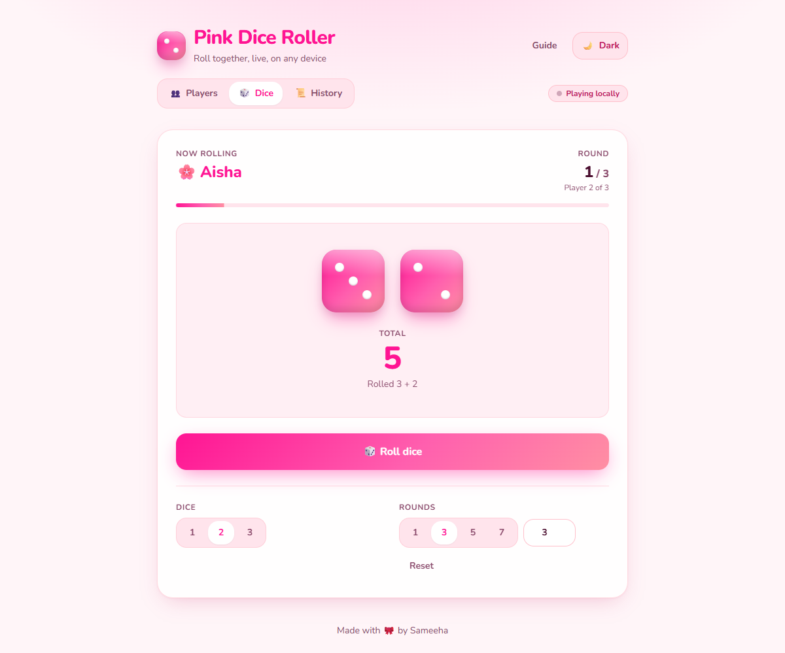
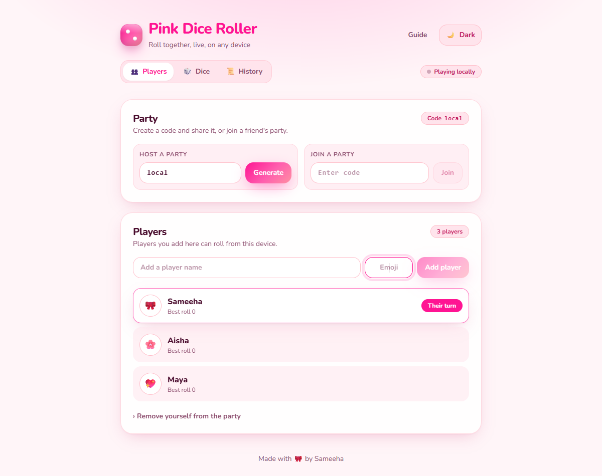
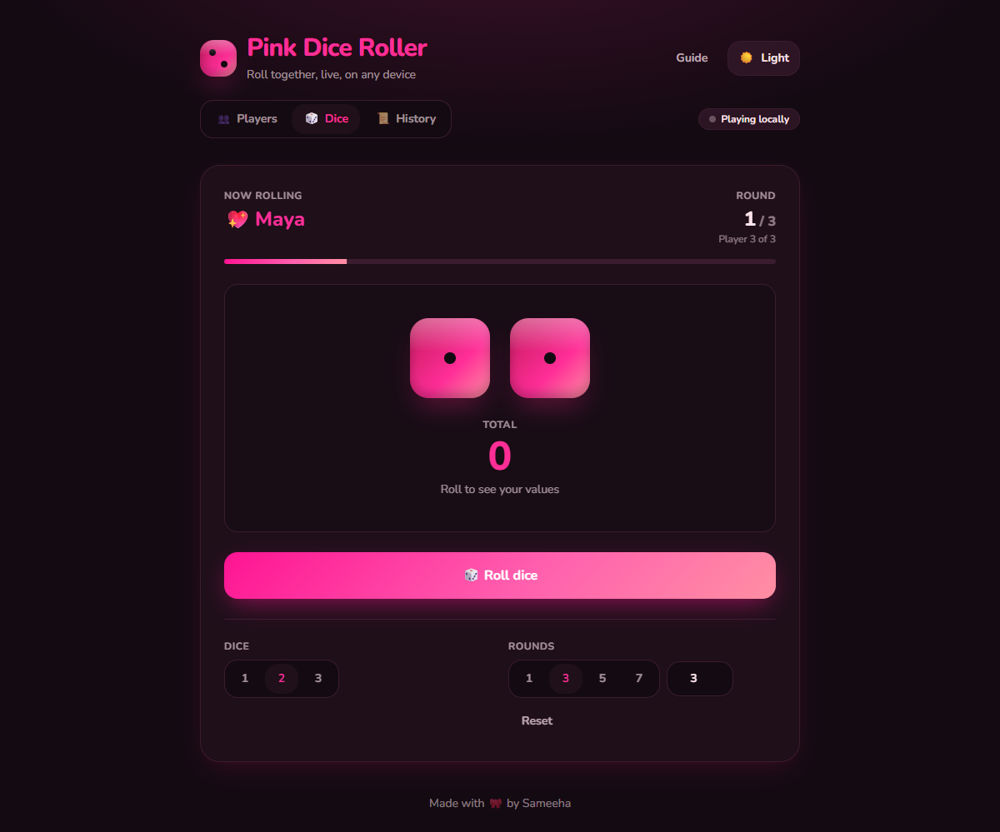

# Pink Dice Roller — React + Vite + Tailwind + Firebase

This project is a modern, aesthetically pleasing Pink Dice Roller built with a focus on mobile responsiveness and smooth user experience. It leverages the speed of Vite, the utility of Tailwind CSS, and the scalability of Firebase.

You can try the live app here: [Pink Dice Roller](https://pink-dice-roller-k5dq.vercel.app/) 

| Dice | Players | Dark mode |
|---|---|---|
|  |  |  |

## Features
- **Serverless Online Play**: Uses Peer-to-Peer (WebRTC) technology. No servers, no API keys, no login. Just share the code!
- Turn-based rounds with auto-advance and winner popup
- Glossy dice with rolling animation, sound, confetti
- Light/Dark themes in Barbie pink, with readable rose text on a plum-black background in dark mode
- Players with emoji, unlimited per device
- Party code to create/join shared games (scopes players and history)
- Per-device roll authorization (only your device’s players can roll)
- History tab with:
  - Clear History (full wipe + game reset)
  - Clear My Rolls (by your name + optional emoji, this device only)
  - Clear Device Rolls (all players registered on this device)
- Responsive UI for small screens (segmented tabs fill the width, forms stack on phones)
- Data persists in localStorage + Syncs via P2P

## Design
- **Same theme, more polish:** Barbie pink gradient, Nunito font and glossy dice are kept; the layout now has a clear hierarchy (header, segmented tabs, cards with titles and descriptions).
- **Dice stage:** large dice, a big total, the current player and a round progress bar, with the Roll button as the single primary action.
- **Consistent controls:** one button system (primary, secondary, ghost, danger), segmented controls for tabs / dice count / rounds, and one input style with a pink focus ring.
- **Motion with a purpose:** buttons scale to 0.97 when pressed, the dice roll uses a strong ease-out curve (520 ms), dialogs fade and scale in once, and all animation is switched off for users who prefer reduced motion.
- **Accessibility:** keyboard focus rings, `aria-selected` / `aria-pressed` on tabs and toggles, labelled inputs, and the Guide closes with Escape.

## Scripts
- `npm run dev` — start local dev server
- `npm run build` — build production assets
- `npm run preview` — preview production build

## Quick Start
- Open Players, press Generate to create a party code (share it)
- Add your name and emoji; your device owns that player
- Switch to Dice, roll — only owned players can roll from this device
- Use History to clear by your name/emoji or device if needed

## About and Branding
- Header shows the active party code badge for quick sharing
- Footer: “made by Sameeha 🎀”
- About modal lists features and usage in bullets

## GitHub Pages
Build and publish `dist/`. If your repo name is `pink-dice-roller`, set:
```
VITE_BASE=/pink-dice-roller/
```
in your environment for correct asset paths.
